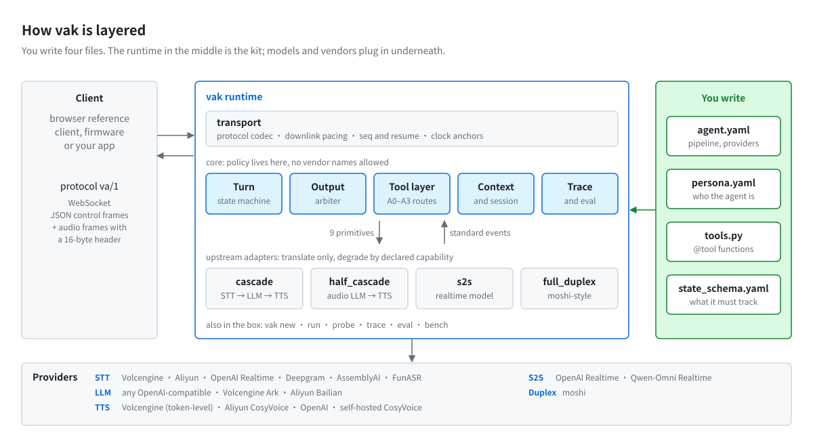
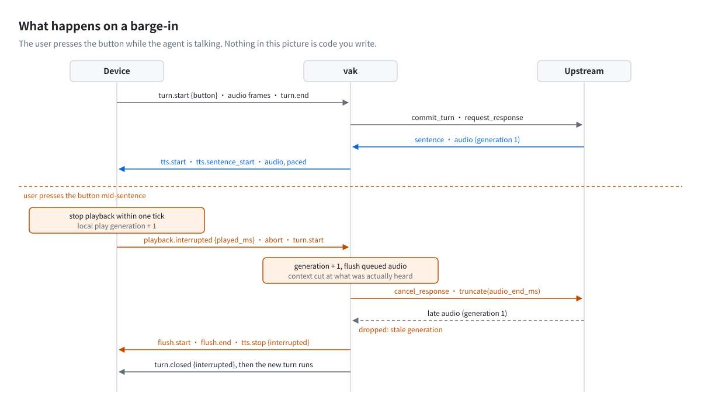

# voice-agent-kit

[English](README.md) · 中文

[](LICENSE)


**基于成文契约实现的实时语音 agent 运行时。** voice-agent-kit（Python 包名 `vak`）内置了回合协议、打断处理、输出仲裁、工具调用收口、会话重建与 trace。开发者只需编写人设、工具函数和 `agent.yaml`。同一个 agent 可以运行在四种链路形态上：级联（STT → LLM → TTS）、半级联、端到端语音模型（S2S）和原生全双工。切换链路时，设备协议和业务代码都不需要修改。

> **当前状态：v0.1。** 四种链路在 mock 上游下均可完整运行，这部分由 1055 项自动化测试覆盖。火山引擎、阿里云、OpenAI、Deepgram、AssemblyAI 等厂商均已接入，但只在协议层面用模拟服务端做过测试，**尚未在真实服务上验证**。详见[状态与限制](#状态与限制)。

<picture>
  <source media="(prefers-color-scheme: dark)" srcset="docs/assets/architecture-dark.svg">
  
</picture>

## 设计动机

语音 agent 的主要工程难点通常不在于选择哪家 ASR 或 TTS，而在于以下问题：

- **打断**：用户插话时，设备需要在约 100 ms 内停止播放，上一条回复的音频也不能进入新的回合。
- **工具调用**：模型在回复中途调用工具时，即使用户打断，这次调用也必须有确定的结局。结果由谁播报、何时播报需要有明确规则，写操作不能重复执行。
- **会话恢复**：网络中断或厂商会话过期后，上下文应当从本地记录恢复，而不是依赖厂商侧的副本。
- **首音定位**：首音延迟达到 3 秒时，需要能够定位耗时集中在哪一段。

这些问题与所选模型无关，却几乎在每个项目中被重复实现，而且往往要反复修正。voice-agent-kit 先把相关规则写成[七份规范](docs/specs/)，再据此实现一个各链路共用的运行时。

## 入门路径

本仓库与 [voice-agent-handbook](https://github.com/wananing/voice-agent-handbook) 配套使用：手册阐述设计原理，本仓库提供可运行、可测量的实现。建议按以下顺序阅读和实践：

1. **掌握基础概念。** 阅读手册的 [01-foundations](https://github.com/wananing/voice-agent-handbook/tree/master/01-foundations)，共六篇，涵盖音频基础、ASR、TTS、VAD 与判停的区别、传输方式，以及[延迟预算](https://github.com/wananing/voice-agent-handbook/blob/master/01-foundations/latency-budget.md)。
2. **运行示例。** 按[快速开始](#快速开始)在 mock 上游下运行 agent，通过浏览器完成对话和打断。这一步不需要任何 API key。
3. **按专题深入。** 遇到具体问题时，先阅读手册中对应的机制页（[判停](https://github.com/wananing/voice-agent-handbook/blob/master/03-mechanisms/turn-detection.md)、[打断](https://github.com/wananing/voice-agent-handbook/blob/master/03-mechanisms/interruption.md)、[首音](https://github.com/wananing/voice-agent-handbook/blob/master/03-mechanisms/first-audio.md)、[工具回合](https://github.com/wananing/voice-agent-handbook/blob/master/03-mechanisms/tool-calls.md)），再查阅 `docs/specs/` 中的相应规范。
4. **测量与优化首音。** 按[首音实验指南](docs/first-audio-lab.md)查看各分段耗时，逐项对照各项优化的效果；接入真实厂商后，用 `vak bench` 在实际网络环境下比较候选方案。

## 开发者需要编写的内容

生成的项目包含 `agent.yaml`、`persona.yaml`、`state_schema.yaml`、`tools.py` 和 `cues/` 目录。链路与 provider 在 `agent.yaml` 中配置：

```yaml
# agent.yaml
profile: A          # A：无屏设备；B：带屏应用
mode: ptt           # ptt：按键说话；open_mic：开放麦（需要客户端回声消除）
pipeline: cascade   # cascade | half_cascade | s2s | full_duplex
providers:
  stt: { type: volcengine_stt, app_key: "${VOLC_ASR_APP_KEY}", access_key: "${VOLC_ASR_ACCESS_KEY}" }
  llm: { type: ark, api_key: "${ARK_API_KEY}", model: doubao-seed-2-0-mini-260428 }
  tts: { type: volcengine_tts, app_key: "${VOLC_ASR_APP_KEY}", access_key: "${VOLC_ASR_ACCESS_KEY}" }
```

工具是普通的异步函数。装饰器只声明工具的属性，播报方式由运行时决定：

```python
@tool(
    presentation="verbatim",              # 按固定模板播报，不经模型再生成
    latency_class="seconds",              # 秒级耗时，执行前先播报确认语
    write=True,                           # 写操作：必须配置门槛与幂等键
    voice_template="好，{item} 已经记下了。",
    idempotency_key=["item"],
    gates=[{"kind": "utterance", "must_match": ["记", "加"], "must_not_match": ["怎么记"]}],
    interrupt_policy="finish_then_notify",
    progress={"ack_template": "好，我记一下。"},
)
async def add_note(item: str) -> dict:
    """记录用户提到的一件事项。"""
    return {"ok": True, "summary": f"记下了：{item}", "data": {"item": item}}
```

运行时根据这些字段完成以下工作：

- **选择播报路线**：直接播报模板；先播报确认语，再播报结果；或者将结果交由模型重新生成回复。
- **校验门槛**：依据用户原话检查门槛条件。
- **去重**：按 `idempotency_key` 去除重复调用。
- **收口**：保证每次调用都以六种终态之一结束，即 `result`、`progress`、`interrupted`、`cancelled`、`superseded`、`duplicate`。

未配置门槛的写操作工具会在启动时被拒绝。业务代码中不会出现 `turn_id`、`generation`、`flush` 等底层概念。

## 运行时提供的能力

<picture>
  <source media="(prefers-color-scheme: dark)" srcset="docs/assets/barge-in-dark.svg">
  
</picture>

- **回合协议**（[规范 01](docs/specs/01-turn-model-and-client-protocol.md)）：每一帧音频都携带 `turn_id`，每个回合都以明确的终态结束。按键模式与开放麦模式是同一状态机的两种配置。连接中断后 30 s 内可以续接。
- **输出仲裁**（[规范 02](docs/specs/02-output-arbiter.md)）：由仲裁器决定发声的主体与顺序。代际在入队、授权和逐帧发送三处校验，过期音频在服务端和设备端都会被丢弃。"用户实际听到了什么"以客户端播放回执为准，而不是以服务端发送完成为准。
- **工具收口**（[规范 03](docs/specs/03-tool-registry-and-call-closure.md)）：包括注册表、四种播报路线、门槛链、幂等键和六种终态，保证不存在未收口的调用。
- **上游契约**（[规范 04](docs/specs/04-upstream-adapter-capabilities.md)）：各链路统一映射为九个原语。厂商差异通过能力声明表达，不在代码中按厂商名称分支；关键能力可由 `vak probe` 实测后写回声明。
- **上下文与会话**（[规范 05](docs/specs/05-context-and-session.md)）：以本地记录为唯一真相，上游会话只是镜像，可以随时据本地记录重建。断线、会话超时和链路切换都按这一方式恢复。
- **trace 与评测**（[规范 06](docs/specs/06-trace-and-evaluation.md)）：每个回合生成一条 trace 记录。首音区分"有声音"和"有内容"两个指标，并按 STT、判停、LLM、切句、TTS 分段记录耗时。`vak eval` 提供决策层与对话层评测。

针对级联链路的首音，运行时还在关键路径之外做了以下优化：

- **双向流式 STT**：识别连接在回合开始时建立。
- **预连接**：回合开始时预先连接 LLM 与 TTS，连接保持 60 s。
- **预合成**：播放当前句的同时合成下一句。
- **token 级 TTS 输入**：火山 TTS 按 token 接收 LLM 输出，每轮回复只建立一个会话。
- **关闭思考模式**：方舟与百炼默认关闭思考模式。

各项优化的测量与对照方法见[首音实验指南](docs/first-audio-lab.md)。

## 快速开始

```bash
git clone https://github.com/wananing/voice-agent-kit && cd voice-agent-kit
uv sync --extra dev
uv run vak new my_agent --pipeline cascade --profile A      # 默认使用 mock provider，无需 API key
uv run vak run my_agent/agent.yaml                           # 浏览器访问 http://localhost:8765/，按住按钮说话
uv run vak trace summarize my_agent/traces/*.jsonl           # 首音 P50 / P90 及分段耗时
```

切换到真实厂商有两种方式：用预设重新生成项目（例如 `--providers volcengine`），或者直接修改 `agent.yaml` 中的 `providers:`。完整步骤见 [docs/getting-started.md](docs/getting-started.md)。

## 链路形态

| 链路 | 组成 | 适用场景 |
|---|---|---|
| `cascade` 级联 | 流式 STT → 文本 LLM → 流式 TTS | 需要可控性、出声前护栏和模型可替换性；中文生产环境的首选 |
| `half_cascade` 半级联 | 音频理解模型（仅输出文本）→ TTS | 需要保留部分副语言信息，同时保留出声前的文本审核层 |
| `s2s` 端到端 | OpenAI Realtime、Qwen-Omni Realtime | 首音延迟优先；可控程度取决于厂商提供的能力 |
| `full_duplex` 原生全双工 | moshi 类模型 | 研究与演示 |

按键模式与开放麦模式适用于所有链路。"可打断的开放麦"是一种交互模式，而非第五种链路。

## 已接入的上游

| 类型 | provider |
|---|---|
| 流式 STT | `volcengine_stt`（bigmodel_async）、`aliyun_stt`（paraformer-realtime-v2）、`openai_realtime_stt`、`deepgram_stt`、`assemblyai_stt`、`funasr`（自托管）；另有非流式的 `openai_stt` |
| LLM | `openai_compat`（任意 OpenAI 兼容接口）、`ark`（火山方舟，默认关闭思考并启用 `service_tier: fast`）、`bailian`（阿里云百炼，默认关闭思考） |
| 流式 TTS | `volcengine_tts`（双向流式，按 token 输入）、`aliyun_tts`（CosyVoice 云服务）、`openai_tts`、`cosyvoice`（自托管） |
| 端到端 S2S | `openai_realtime`、`dashscope_realtime` |
| 全双工 | `moshi` |

`vak new --providers` 提供以下级联预设：

| 预设 | 组成 | 所需凭据 |
|---|---|---|
| `volcengine` | 火山语音识别 + 火山方舟 + 火山语音合成 | 一组火山引擎凭据 |
| `aliyun` | 百炼语音识别 + 百炼大模型 + CosyVoice | 一个 DashScope API key |
| `cloud` | 三个环节均使用 OpenAI | OpenAI API key |
| `selfhost_zh` | FunASR + CosyVoice + 自部署 LLM | 无 |

新增 provider 只需实现一个小型接口，见[贡献指南 §5](docs/contributing.md#5-加一个-provider)。各 provider 的配置项、环境变量与已知问题见 [docs/providers.md](docs/providers.md)。

## 命令行工具

| 命令 | 功能 |
|---|---|
| `vak new` | 从模板生成 agent 项目 |
| `vak run` | 启动 WebSocket 网关，并提供浏览器参考客户端 |
| `vak probe` | 对 S2S 上游运行 P0 能力探针，并将结果写回能力声明 |
| `vak trace check / summarize` | 校验 trace，统计首音及分段耗时 |
| `vak eval l0 / l1` | 决策层与对话层评测 |
| `vak bench` | 在实际网络环境下分别测量级联各环节候选方案的耗时，并对组合排序（[docs/bench.md](docs/bench.md)） |

## 与 pipecat、LiveKit Agents、TEN 的关系

上述项目是通用框架，具备大规模插件生态、WebRTC 传输和电话接入能力。voice-agent-kit 的定位更窄，也不基于其中任何一个构建。它是一个由成文契约约束行为的网关运行时，重点在于以下几项：

- 面向资源受限硬件的设备协议；
- 输出仲裁；
- 工具调用收口；
- 四种链路之间基于能力声明的降级。

如果项目需要 WebRTC 房间、电话线路或大量现成集成，建议选用上述框架。如果项目需要对打断、工具与会话行为做出明确规定、能够测试并移植到固件，voice-agent-kit 更为适合。

本项目的设计取舍源自对 28 个开源语音项目的分析，上述三个框架均包括在内，分析结果整理为 [voice-agent-handbook](https://github.com/wananing/voice-agent-handbook)。规范与代码注释中的出处简写（KM、HC、`notes/…` 等）可按 [docs/specs/README.md](docs/specs/README.md#出处简写对照) 中的对照表在手册中查到。

## 文档

| 文档 | 内容 |
|---|---|
| [getting-started](docs/getting-started.md) | 在 mock 上游下运行，再切换到真实 provider |
| [architecture](docs/architecture.md) | 分层结构、四种链路如何统一到同一接口、模块接口、集成约定 |
| [specs/](docs/specs/) | 规范 00–06（契约本体）；代码注释中的"spec 0X §y"均指此处 |
| [first-audio-lab](docs/first-audio-lab.md) | 首音的分段测量、各项优化的位置与对照实验方法 |
| [protocol](docs/protocol.md) | 设备协议 va/1，以及接入新客户端或固件的步骤 |
| [providers](docs/providers.md) | provider 配置、环境变量、已知问题与待验证事项 |
| [bench](docs/bench.md) | 测速方法，以及注明来源的参考数据 |
| [contributing](docs/contributing.md) | 契约文件、代码与测试约定、新增 provider 的方法 |
| [examples/](examples/) | 六个示例项目与一份测速配置 |
| [clients/web/](clients/web/) | 无依赖的浏览器参考客户端；`protocol.js` 可移植到固件 |

## 状态与限制

- **已验证**：
  - 1055 项 Python 测试与 17 项浏览器客户端 Node 测试全部通过。
  - 四种链路在 mock 上游下覆盖了完整回合、打断、文本回合、开放麦判停和 WebSocket 续接。
  - 四种链路均通过同一套上游一致性（conformance）测试。
- **尚未在真实服务上验证**：
  - 所有真实 provider 仅用模拟的 WebSocket 与 HTTP 服务端测试过。
  - 尚未对真实上游运行 P0 探针，能力声明中的关键字段仍为 `code_read` 或 `unknown`。
  - 各 provider 的待验证事项见 [docs/providers.md](docs/providers.md)。
- **未校准**：规范中标注为【建议值，需实测】的参数。
- **尚未实现**：
  - 开放麦模式下的抢先生成。
  - 自托管 CosyVoice 的首块流式输出（官方服务端未开启流式）。
  - `aliyun_tts` 的 token 级输入。
  - WebRTC 传输。

现阶段最有价值的贡献是真实上游的测量数据，包括 `vak bench` 输出、探针结果或 trace，请同时注明网络条件。

## 参与贡献

请先阅读 [docs/contributing.md](docs/contributing.md)。提交前请运行：

```bash
uv run pytest -q && uv run ruff check vak tests && node --test clients/web/
```

以上检查均不需要网络连接或 API key。

## 许可证

本项目采用 [MIT](LICENSE) 许可证。[voice-agent-handbook](https://github.com/wananing/voice-agent-handbook) 单独采用 CC BY 4.0 许可证。
